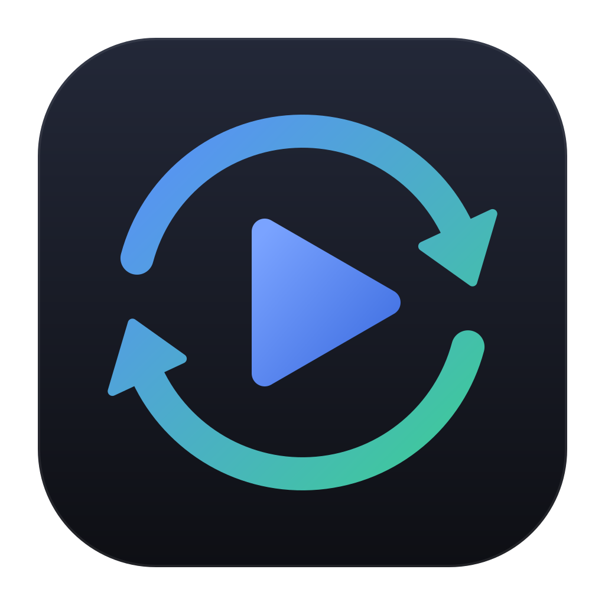
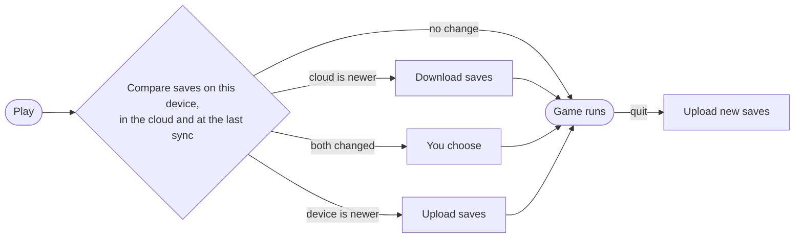

<p align="center">
  
</p>

<h1 align="center">Carryover</h1>

<p align="center">
  <strong>Carry your game saves between PCs, Macs, Steam Deck and Android using your own cloud storage.</strong>
</p>

<p align="center">
  <a href="https://github.com/akfaiz/carryover/releases"></a>
  <a href="https://github.com/akfaiz/carryover/actions/workflows/ci.yml"></a>
  <a href="https://codecov.io/gh/akfaiz/carryover"></a>
  <a href="https://github.com/akfaiz/carryover/releases"></a>
  <a href="go.mod"></a>
  <a href="LICENSE"></a>
</p>

<p align="center">
  <a href="#download"></a>
  <a href="#download"></a>
  <a href="#download"></a>
  <a href="#download"></a>
  <a href="#download"></a>
</p>

A game launcher for Windows, macOS and Linux / Steam Deck, with an Android app, that keeps your save
games in sync through your own cloud storage. Carryover downloads the latest saves before you play and uploads them
when you quit, from its own launcher or from Steam, including Game Mode.

Cloud storage: Google Drive, Dropbox, OneDrive, WebDAV (Nextcloud, ownCloud, NAS), SFTP and SMB.
[rclone](https://github.com/rclone/rclone) is built in, so there is nothing else to install.

## Screenshots

<p align="center">
  
</p>

## Features

- **A save folder for each device** — the same game can keep its saves in a different place on each device, and
  Carryover keeps them in step. See [Save paths](docs/save-paths.md).
- **Save folders suggested** — Carryover can find the save folder of about 21,000 PC games and of many emulated
  games, also for games run through Proton, Heroic, Lutris or Bottles.
- **Play from Carryover or from Steam** — **Add to Steam** makes a shortcut that syncs every time you play, also in
  Game Mode. On Linux, Heroic and Lutris games still run through Heroic or Lutris.
- **Controller support** — add Carryover to Steam and you can use the whole app with a gamepad in Game Mode.
- **Safe conflicts** — if saves changed on two devices, you choose which to keep. Before a download replaces the
  saves on your device, Carryover keeps a copy of them there. Turn on cloud backups to also back up saves in the
  cloud before they're replaced, and restore them from the game's page.
- **Emulators** — set up Eden, Ryujinx and others once on each device. A game can use more than one, each with its
  own saves. Choosing a game file suggests the game's name and save folders.
- **Android** — play emulated games on a phone, handheld or TV with the same saves as on your PC. Press **Play**:
  Carryover syncs, opens the emulator and uploads your saves when you leave the game. You can also start games from
  ES-DE or Daijisho, and Lemon on Android can share Eden's saves with your PC.
- **Played without Carryover?** — games whose saves changed outside Carryover are marked "not uploaded".
- **Shared library** — your game list, covers and artwork appear on all your devices. A game added on your PC shows
  up on your Steam Deck as "needs setup". Titles come from Steam, and covers from SteamGridDB (with your own free
  API key).
- **Trash** — restore deleted games and emulators for 30 days, and clean up cloud saves that no game uses any more.

## Download

Get the latest version from the [Releases page](https://github.com/akfaiz/carryover/releases/latest).

File names include the version, for example `carryover-0.5.1-windows-amd64.zip`. On Windows, pick the installer or
the portable zip; both hold the same program.

| Platform | File | How to run |
|---|---|---|
| Windows (installer) | `carryover-<version>-windows-amd64-setup.exe` | Run it. No admin rights needed. It adds Carryover to the Start menu. |
| Windows (portable) | `carryover-<version>-windows-amd64.zip` | Extract `carryover.exe` and run it from any folder. |
| Steam Deck, Linux | `carryover-<version>-linux-amd64.AppImage` | Rename it to `carryover.AppImage`, allow it to run as a program (right-click → Properties → Permissions) and open it. |
| Linux | `carryover-<version>-linux-amd64.tar.gz` | Extract it and run `./install.sh` to add Carryover to your applications menu. |
| macOS 12+ (Apple Silicon and Intel) | `carryover-<version>-macos-universal.zip` | Open the zip and drag Carryover to Applications. |
| Android 8+ | `carryover-<version>-android-arm64-v8a.apk` (phones, handhelds, TV boxes; `…-x86_64.apk` for Chromebooks) | Open it on the device and allow your browser or file manager to install apps when Android asks. |

- **Keep the app in one place, under one name.** Steam shortcuts made with **Add to Steam** point at the file, so
  don't move or rename it afterwards. Choose a folder it can stay in (for example `~/Applications` on the Deck). On
  the Deck, run it from Desktop Mode the first time.
- **Windows warns on first run.** Carryover isn't code-signed yet, so you may see "Windows protected your PC".
  Choose **More info → Run anyway**.
- **macOS blocks the first start.** Carryover isn't signed or notarized by Apple, so macOS says it can't check it
  for malware. Open it once, then go to System Settings → Privacy & Security and choose **Open Anyway**.
- **Android asks once for Usage access.** It lets Carryover see that you left a game, to upload its saves right away.
  On Android 13+, you must first allow it for an app installed from a downloaded file: App info → ⋮ → **Allow
  restricted settings**. The app shows you where.
- **Uninstalling:** on Windows (installer), use Settings → Apps; on macOS, move Carryover to the Trash. Your settings
  and library are kept. On Android, uninstalling removes the app's settings on the phone, not your cloud saves.
- **Your version** is shown in Settings → About.

For checking a download, more Linux install options and where your settings are kept, see
[Troubleshooting](docs/troubleshooting.md).

## Updating

Carryover tells you when a new version is available. On a computer, select **Update available** in the sidebar,
then **Download and restart**. On Android, open **Settings → Updates** and tap the new version. You can read what's
new before you install it. Carryover never installs an update without asking, or while a game is being played or a
sync is running.

In **Settings → Updates**, you can choose:

- **Stable** (recommended): finished versions only.
- **Pre-release**: new features earlier, but they may have more bugs. Switching back to Stable doesn't install an
  older version.

You can also turn off automatic checks.

- **macOS:** move Carryover to Applications first.
- **Android:** Android asks you to confirm the install. The first time, it also asks you to let Carryover install
  apps. Your setup is kept.
- **Version 0.5.1 and older** can't update themselves. Install a newer version yourself once: run the new installer,
  or replace the old file with the new one under the same name.

If Carryover can't update itself, see [Troubleshooting](docs/troubleshooting.md#carryover-cant-update-itself).

## Getting started

On each device:

1. **Connect your cloud storage** — select **＋ Add remote** (a "remote" is a connection to your cloud account). If
   you already use rclone, you can import its settings instead. The first one you add is where your saves are synced;
   check the folder under **Sync location**. Use the same account and folder on every device.
2. **Add a game** — select **＋ Add game** and choose "From Steam", "PC game" or "Emulated game". Then set how it
   starts and where its saves are on this device. Carryover suggests the save folder for games it knows.
3. **Play** — press **▶ Play**, or use **Add to Steam** and start the game from Steam. On another device, the game
   shows up as "needs setup": set its save folder there, and your saves follow you. For Proton and Heroic games, see
   [Steam and Steam Deck](docs/steam-deck.md).

**On Android**, add the same cloud account and folder under Settings → Cloud. Games your PC plays with an emulator
that has an Android app show up. On the Emulators tab, choose which app each emulator is. Then open a game, pick its
save folder (**Suggest save folders** finds it for emulators it knows) and press **Play**. To start games from
ES-DE or Daijisho, see [Android: start games from a frontend](docs/android-frontends.md).

## How it works



Carryover keeps one copy of each game's saves in the cloud. Before you play, it compares the saves on this device
with that copy and with what it saw at the last sync. Then it downloads or uploads them, or asks you which to keep if
both changed. Only changed files are transferred, and you get a warning if the game is being played on another
device. After you quit, your new saves are uploaded. See [How Carryover syncs saves](docs/how-it-works.md) for the
details and the backup options.

> [!NOTE]
> **Steam's "Exit game" / "Stop" is fine.** Carryover still uploads your saves a few seconds later and lets you
> know with a notification (in Steam Deck Game Mode, the next time you open Carryover). With Flatpak Steam, or on
> Linux without systemd, press "Sync now" before you play on another device.

## Command line

```
carryover                       open the launcher
carryover run <game> [-- cmd]   pull → play → push (used by Steam shortcuts)
carryover sync <game>|--all     manual sync (exit code 3 = conflict)
carryover list                  list games and their ids
carryover update [--check]      install the newest version
```

All options are in [docs/cli.md](docs/cli.md).

## Documentation

- [How Carryover syncs saves](docs/how-it-works.md) — conflicts, backups, the cloud lock
- [Steam and Steam Deck](docs/steam-deck.md) — Proton shortcuts, Heroic games, Game Mode
- [Save paths](docs/save-paths.md) — every path variable (`{appdata}`, `{proton:shortcut}`, …)
- [Command line](docs/cli.md) — commands, options and environment variables
- [Android: start games from a frontend](docs/android-frontends.md) — ES-DE, Daijisho, home-screen shortcuts
- [Troubleshooting](docs/troubleshooting.md) — logs, installing and updating, checking a download, missing uploads, Android
- [Compared with other tools](docs/comparison.md)
- [Privacy policy](PRIVACY.md)

## Compared with other tools

[Ludusavi](https://github.com/mtkennerly/ludusavi) backs up and restores saves on one machine.
[OpenSave](https://github.com/Liquid-co/OpenSave) syncs every change peer-to-peer between paired devices.
[EmuSync](https://github.com/emu-sync/EmuSync) syncs saves to your cloud storage from a background service on a timer.
[Hoard](https://github.com/rleeon/hoard) keeps every version of your saves on a Hoard server, hosted or your own,
from a background service.
Carryover keeps one copy in your own cloud storage and syncs it around each play session. See
[docs/comparison.md](docs/comparison.md) for a side-by-side comparison.

## Building from source

See [CONTRIBUTING.md](CONTRIBUTING.md) for build, test and Linux / Steam Deck, macOS and Android packaging
instructions, [Architecture](docs/architecture.md) for how the code is organised, and
[Android architecture](docs/android-architecture.md) for how the Android app works.

## License

Carryover is free software under the [GNU General Public License v3.0 or later](LICENSE) (GPL-3.0-or-later)
© 2026 Ahmad Faiz.

## Credits

- Save locations come from the [Ludusavi manifest](https://github.com/mtkennerly/ludusavi-manifest)
  (MIT), compiled from [PCGamingWiki](https://www.pcgamingwiki.com/).
- Save locations of emulated games come from
  [ludusavi-emulator-manifests](https://github.com/sharkusmanch/ludusavi-emulator-manifests), downloaded on demand
  when you use the suggestion feature (built from public game databases such as blawar/titledb and GameTDB).
