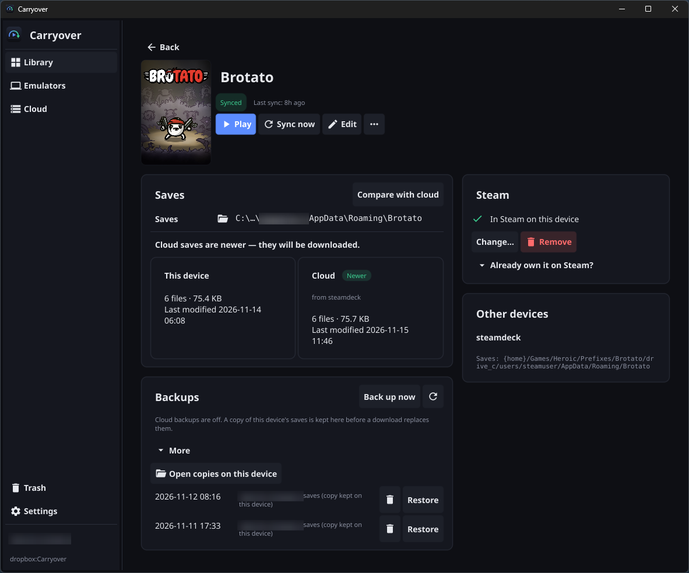
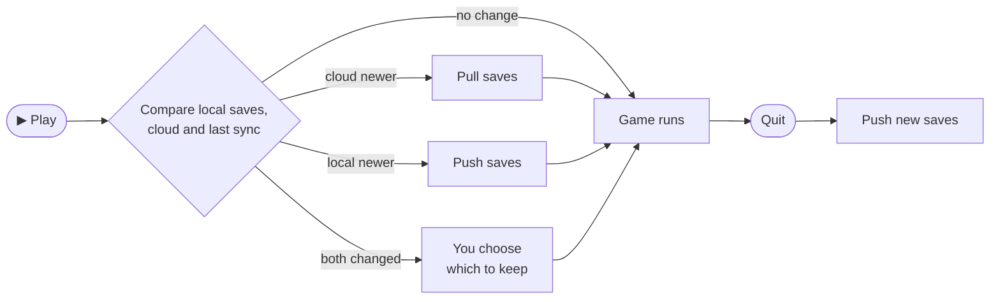

<p align="center">
  
</p>

<h1 align="center">Carryover</h1>

<p align="center">
  <strong>Carry your game saves between PCs and Steam Deck using your own cloud storage.</strong>
</p>

<p align="center">
  <a href="https://github.com/akfaiz/carryover/releases"></a>
  <a href="https://github.com/akfaiz/carryover/actions/workflows/ci.yml"></a>
  <a href="https://codecov.io/gh/akfaiz/carryover"></a>
  <a href="LICENSE"></a>
</p>

A game launcher for Windows and Linux / Steam Deck that keeps your save games in sync through your own cloud
storage. Carryover pulls the latest saves before you play and pushes them when you quit, from its own launcher or
from Steam, including Game Mode.

Cloud storage: Google Drive, Dropbox, OneDrive, WebDAV (Nextcloud, ownCloud, NAS), SFTP and SMB.
[rclone](https://github.com/rclone/rclone) is built in, so there is nothing else to install.

## Screenshots

<p align="center">
  
</p>

## Features

- **Per-device save paths** — one game, one cloud copy; each device maps it to its own folder
  (`{appdata}/GameA` on Windows, `{proton:shortcut}/AppData/Roaming/GameA` on a Steam Deck).
- **Save locations suggested** — known save folders for ~21,000 games, translated for each device, including
  Proton, Heroic, Lutris and Bottles prefixes on Linux.
- **Play from the launcher or from Steam** — "Add to Steam" creates a shortcut that syncs around every session,
  even in Game Mode, with prompts that work on a controller.
- **Safe conflicts** — if saves changed on both sides, you choose which to keep, and the side being overwritten
  is backed up first.
- **Emulators** — set up an emulator (Eden, Ryujinx, …) once per device and let a game use several; each keeps
  its own saves in the cloud. Choosing a ROM suggests the game's name and save folders.
- **Played without Carryover?** — games whose saves changed outside Carryover are marked "not uploaded".
- **Shared library** — the game list, covers and artwork sync between devices; a game added on the PC shows up on
  the Deck as "needs setup". Titles come from Steam, covers from SteamGridDB (with your own free API key).
- **Trash and cleanup** — deleted games and emulators can be restored for 30 days, and cloud saves no game uses
  any more can be restored or deleted.

## Download

Get the latest version from the [Releases page](https://github.com/akfaiz/carryover/releases/latest).

Every file is named `carryover-<version>-<os>-<arch>`, for example `carryover-0.2.1-windows-amd64.exe`.

| Platform | File | How to run |
|---|---|---|
| Windows | `carryover-<version>-windows-amd64.exe` | Rename it to `carryover.exe` and run it; there is no installer. |
| Steam Deck, Linux | `carryover-<version>-linux-amd64.AppImage` | Rename it to `carryover.AppImage`, make it executable (file Properties → Permissions, or `chmod +x`) and run it. |
| Linux | `carryover-<version>-linux-amd64.tar.gz` | Extract it and run `./install.sh` (installs into `~/.local` and adds a menu entry), or `sudo ./install.sh /usr/local` for every user. |

- **Keep the app in one place, under one name.** Steam shortcuts made with "Add to Steam" point at the file's path,
  which is why the exe and AppImage are renamed without the version. Put them in a folder you won't move them out
  of (for example `~/Applications` on the Deck). On the Deck, run it from Desktop Mode the first time.
- **Windows warns on first run.** The exe isn't code-signed yet, so SmartScreen shows "Windows protected your PC";
  choose **More info → Run anyway**.
- **Check a download** against `SHA256SUMS.txt` from the same release: `sha256sum -c SHA256SUMS.txt --ignore-missing`
  on Linux, or compare the output of `Get-FileHash <file>` in PowerShell on Windows.
- **Updating:** download the new version and rename it over the old file (`carryover.exe` or `carryover.AppImage`),
  so Steam shortcuts keep working. The AppImage can also update itself through
  [Gear Lever](https://flathub.org/apps/it.mijorus.gearlever) or AppImageUpdate (full releases only, not
  pre-releases). For the tarball, run `install.sh` from the new version.
- `carryover --version`, or Settings → About, shows which version you have.

## Getting started

On each device:

1. **Cloud storage** — add a remote with "＋ Add remote" (or import your existing rclone config). The first one
   becomes the sync location; check its folder under "Sync location". Every device must use the same remote and
   folder.
2. **＋ Add game** — choose "From Steam", "PC game" or "Emulated game", then set how it starts and its save folder
   on this device. Suggested save locations are listed for known games.
3. **▶ Play**, or use "Add to Steam" and start the game from Steam. On the other device, the game shows up as
   "needs setup": set its save folder there, and the saves follow you. For Proton and Heroic games, see
   [Steam and Steam Deck](docs/steam-deck.md).

## How it works



Each game has one copy of its saves in the cloud. Before you play, Carryover compares the local saves, the cloud
copy and what it saw at the last sync, then pulls, pushes, or asks you when both sides changed. Only changed files
are transferred, and a cloud lock shows when the game is being played on another device. After you quit, the new
saves are pushed. See [How Carryover syncs saves](docs/how-it-works.md) for the details and the backup options.

> [!NOTE]
> **Steam's "Exit game" / "Stop" is fine.** Carryover still uploads your saves a few seconds later and lets you
> know with a notification (in Steam Deck Game Mode, the next time you open Carryover). On Linux this needs systemd,
> which SteamOS has; without it (e.g. Flatpak Steam), press "Sync now" before you play on another device.

## Command line

```
carryover                       open the launcher
carryover run <game> [-- cmd]   pull → play → push (used by Steam shortcuts)
carryover sync <game>|--all     manual sync (exit code 3 = conflict)
carryover list                  list games and their ids
```

All options are in [docs/cli.md](docs/cli.md).

## Documentation

- [How Carryover syncs saves](docs/how-it-works.md) — conflicts, backups, the cloud lock
- [Steam and Steam Deck](docs/steam-deck.md) — Proton shortcuts, Heroic games, Game Mode
- [Save paths](docs/save-paths.md) — every path variable (`{appdata}`, `{proton:shortcut}`, …)
- [Command line](docs/cli.md) — commands, options and environment variables
- [Troubleshooting](docs/troubleshooting.md) — logs, SmartScreen, missing uploads
- [Compared with other tools](docs/comparison.md)

## Compared with other tools

[Ludusavi](https://github.com/mtkennerly/ludusavi) backs up and restores saves on one machine.
[OpenSave](https://github.com/Liquid-co/OpenSave) syncs every change peer-to-peer between paired devices.
[EmuSync](https://github.com/emu-sync/EmuSync) syncs saves to your cloud storage from a background service on a timer.
Carryover keeps one copy in your own cloud storage and syncs it around each play session. See
[docs/comparison.md](docs/comparison.md) for a side-by-side comparison.

## Building from source

See [CONTRIBUTING.md](CONTRIBUTING.md) for build, test and Linux / Steam Deck packaging instructions.

## License

[MIT](LICENSE) © 2026 Ahmad Faiz Kamaludin

## Credits

- Save locations come from the [Ludusavi manifest](https://github.com/mtkennerly/ludusavi-manifest)
  (MIT), compiled from [PCGamingWiki](https://www.pcgamingwiki.com/).
- Save locations of emulated games come from
  [ludusavi-emulator-manifests](https://github.com/sharkusmanch/ludusavi-emulator-manifests), downloaded on demand
  when you use the suggestion feature (built from public game databases such as blawar/titledb and GameTDB).
