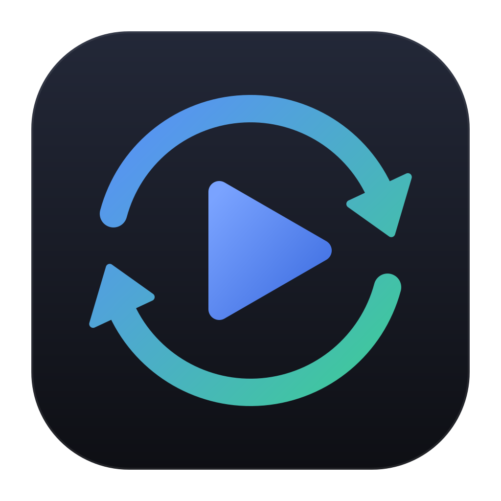

<p align="center">
  
</p>

<h1 align="center">Carryover</h1>

<p align="center">
  <strong>Carry your game saves between PCs and Steam Deck using your own cloud storage.</strong>
</p>

<p align="center">
  <a href="https://github.com/akfaiz/carryover/releases"></a>
  <a href="https://github.com/akfaiz/carryover/actions/workflows/ci.yml"></a>
  <a href="LICENSE"></a>
</p>

A game launcher for Windows and Linux / Steam Deck that keeps your save games in sync through your own cloud
storage. Carryover pulls the latest saves before you play and pushes them when you quit, from its own launcher or
from Steam, including Game Mode.

Cloud storage: Google Drive, Dropbox, OneDrive, WebDAV (Nextcloud, ownCloud, NAS), SFTP and SMB.
[rclone](https://github.com/rclone/rclone) is built in, so there is nothing else to install.

## Features

- **Per-device save paths** — one game, one cloud copy; each device maps it to its own folder
  (`{appdata}/GameA` on Windows, `{proton:shortcut}/AppData/Roaming/GameA` on a Steam Deck).
- **Emulators** — set up an emulator (Eden, Ryujinx, …) once per device, then let a game use several of them.
  Each emulator keeps its own saves in the cloud, so they never mix; the same emulator on another device
  shares them.
- **Trash and cleanup** — a deleted game or emulator waits in the Trash for 30 days and can be restored with all
  its settings. Deleting can also remove its cloud saves, and the Trash page lists cloud saves that no game uses
  any more, to restore or delete.
- **Play from the launcher or from Steam** — "Add to Steam" creates a non-Steam shortcut that runs
  `carryover run <game>`, so saves sync around every session, even in Game Mode.
- **Safe conflicts** — if saves changed on both sides, you choose which to keep. The side being overwritten is
  backed up first (see [How it works](#how-it-works)).
- **Played without Carryover?** — when the launcher opens or regains focus, it checks for saves that changed
  since their last sync (for example, the game was started outside Carryover) and marks those games "not uploaded".
- **Save locations suggested** — known save folders for ~21,000 games (from the Ludusavi manifest), translated
  for each device: Windows folders on a PC, the Proton prefix or native Linux folders on a Steam Deck. Folders
  that already hold saves are shown first. On Linux, the Wine prefixes of Heroic, Lutris and Bottles (native or
  Flatpak, including the SD card) are searched too.
- **Title & cover from Steam** — "Find on Steam" fills in the official title and portrait cover; "Add from Steam"
  imports games installed through Steam. With your own free [SteamGridDB](https://www.steamgriddb.com) API key
  (Settings), "Find cover…" searches community covers for any game.
- **Shared library** — the game list, covers and artwork sync between devices; a game added on the PC shows up on
  the Deck as "needs setup".

## Download

Get the latest version from the [Releases page](https://github.com/akfaiz/carryover/releases).

Every file is named `carryover-<version>-<os>-<arch>`, for example `carryover-0.1.0-windows-amd64.exe`.

| Platform | File | How to run |
|---|---|---|
| Windows | `carryover-<version>-windows-amd64.exe` | Rename it to `carryover.exe` and run it; there is no installer. |
| Steam Deck, Linux | `carryover-<version>-linux-amd64.AppImage` | Rename it to `carryover.AppImage`, make it executable (file Properties → Permissions, or `chmod +x`) and run it. |
| Linux | `carryover-<version>-linux-amd64.tar.gz` | Extract it and run `./install.sh` (installs into `~/.local` and adds a menu entry), or `sudo ./install.sh /usr/local` for every user. |

- **Keep the app in one place, under one name.** Steam shortcuts made with "Add to Steam" point at the file's path,
  which is why the exe and AppImage are renamed without the version. Put them in a folder you won't move them out
  of (for example `~/Applications` on the Deck). On the Deck, run it from Desktop Mode the first time.
- **Windows warns on first run.** The exe isn't code-signed yet, so SmartScreen shows "Windows protected your PC";
  choose **More info → Run anyway**.
- **Check a download** against `SHA256SUMS.txt` from the same release: `sha256sum -c SHA256SUMS.txt --ignore-missing`
  on Linux, or compare the output of `Get-FileHash <file>` in PowerShell on Windows.
- **Updating:** download the new version and rename it over the old file (`carryover.exe` or `carryover.AppImage`),
  so Steam shortcuts keep working. The AppImage can also update itself through
  [Gear Lever](https://flathub.org/apps/it.mijorus.gearlever) or AppImageUpdate (full releases only, not
  pre-releases). For the tarball, run `install.sh` from the new version.
- `carryover --version`, or Settings → About, shows which version you have.

## Getting started

On each device:

1. **Cloud storage** — add a remote with "＋ Add remote" (or import your existing rclone config), then pick it and
   a folder under "Sync location". Every device must use the same remote and folder.
2. **＋ Add game** — set the game's executable and its save folder on this device. Suggested save locations are
   listed for known games.
3. **▶ Play**, or use "Add to Steam" and start the game from Steam. On the other device, the game shows up as
   "needs setup": set its save folder there, and the saves follow you.

## How it works

Each game has one copy of its saves in the cloud. Every device keeps a record of the cloud state it saw at its
last successful sync, and compares three things: its local save files, the cloud copy and that record.

1. **Before playing**, Carryover scans the local save folders and reads the cloud manifest (the file list with a
   SHA-256 for each file). It also writes a lock in the cloud ("being played on `<device>`") so another device
   knows the game is in use.
2. **It decides what to do:**

   | Local | Cloud | Result |
   |---|---|---|
   | unchanged | unchanged | nothing to do |
   | unchanged | newer | **pull** the cloud saves |
   | changed | unchanged | **push** the local saves |
   | changed | changed (and different) | **conflict**, you choose which side to keep |

   A device that has never synced the game pulls if it has no local saves, pushes if the cloud has none, and
   reports a conflict if both have different saves.
3. **Only the difference is transferred.** Files are compared by size and SHA-256, so unchanged files are not
   uploaded or downloaded again, and files that were deleted on one side are removed on the other.
4. **The side being overwritten is backed up first.**
   - With **"Back up saves to the cloud before they're overwritten"** turned on in Settings (off by default,
     because the upload slows syncs), it is zipped into the game's cloud backups. The last N are kept.
   - With it off, a download that would replace this device's saves first zips them on the device
     (the last 5 per game). Nothing is uploaded.
   - "Back up now" on the game page makes a manual backup. Manual backups are pinned, and pinned backups are never
     deleted automatically. You can pin any backup, and restore any of them from the game page.
5. **After you quit the game**, the new local saves are pushed and the lock is released.

In Steam, the shortcut `carryover run <game>` does the same steps around the game process. You can cancel a sync
while it runs, but never the game itself.

## Steam Deck / Proton games

Pick **"Steam"** as the game's launch mode and, in "Add to Steam", set **Shortcut type** to
**"Run the game exe, wrapped by Carryover"**. Steam gets the game `.exe` as target and
`"<carryover>" run <id> -- %command%` as launch options; force a Proton version in the shortcut's
Compatibility settings. For games you own on Steam, paste the launch options shown on the game page.

Games installed by **Heroic** (GOG, Epic, Amazon, or added by hand) should keep Heroic's own Wine prefix: a
Proton shortcut would give them a new, empty one. Pick **"Heroic Games Launcher"** as launch mode;
choosing an executable inside a Heroic install folder selects it automatically. Carryover then launches the game
with `heroic://launch` (as Heroic's own "Add to Steam" does) and waits for that executable to exit. The Steam
shortcut runs Carryover, so don't force a Proton version on it. Pick the save folder from the Heroic prefix
suggestions. On Windows the mode works the same way: Carryover runs `Heroic.exe --no-gui heroic://launch?…`,
which Epic games need for their login.

## Path variables

Save paths can use variables, so one entry works on every device. The most common are `{home}`, `{documents}`,
`{appdata}`, `{localappdata}`, `{savedgames}`, `{localappdatalow}` (Windows `AppData\LocalLow`), `{xdgdata}`, `{xdgconfig}` and `{steam}`, plus
`{proton:<appid>}` (a Steam game's Proton prefix, `…/compatdata/<appid>/pfx/drive_c/users/steamuser`) and
`{proton:shortcut}` (the prefix of this game's own non-Steam shortcut). `$ENV` and `%ENV%` work too.
The `{ }` button next to a path field lists every variable with its value on the current device.

## Command line

```
carryover                                    open the launcher
carryover run <game> [--emulator <e>] [--headless] [--no-sync] [-- cmd]
                                             pull → play → push (used by Steam shortcuts)
carryover sync <game>|--all [--emulator <e>] [--push|--pull] [--dry-run] [--yes]
                                             manual sync (exit code 3 = conflict)
carryover list                               list games and their ids
carryover --version                          print the version
```

- `<game>` is a game id or its exact name. With `-- cmd` (for example Steam's `-- %command%`), that command is
  launched instead of the configured exe.
- `--emulator` picks an emulator (id or name, or `native` for the game's own launch config). `run` without it
  plays the one used last on this device; `sync` without it syncs every emulator set up on this device.
- `--headless` never waits for input: conflicts are skipped, both sides stay untouched, and the game is flagged
  in the launcher until you resolve it.
- `--no-sync` launches the game without syncing before or after.
- `--dry-run` shows what would happen without changing anything. `--all` with `--push` or `--pull` asks first;
  `--yes` (`-y`) skips the question.
- Set `CARRYOVER_HOME` to use a different data directory (default: `Carryover` in the user config dir).

## Compared with other tools

[Ludusavi](https://github.com/mtkennerly/ludusavi) backs up and restores saves on one machine.
[OpenSave](https://github.com/Liquid-co/OpenSave) syncs every change peer-to-peer between paired devices.
Carryover keeps one copy in your own cloud storage and syncs it around each play session. See
[docs/comparison.md](docs/comparison.md) for a side-by-side comparison.

## Building from source

See [CONTRIBUTING.md](CONTRIBUTING.md) for build, test and Linux / Steam Deck packaging instructions.

## License

[MIT](LICENSE) © 2026 Ahmad Faiz Kamaludin

## Credits

- Save locations come from the [Ludusavi manifest](https://github.com/mtkennerly/ludusavi-manifest)
  (MIT), compiled from [PCGamingWiki](https://www.pcgamingwiki.com/).
- Save locations of emulated games come from
  [ludusavi-emulator-manifests](https://github.com/sharkusmanch/ludusavi-emulator-manifests), downloaded on demand
  when you use the suggestion feature (built from public game databases such as blawar/titledb and GameTDB).
