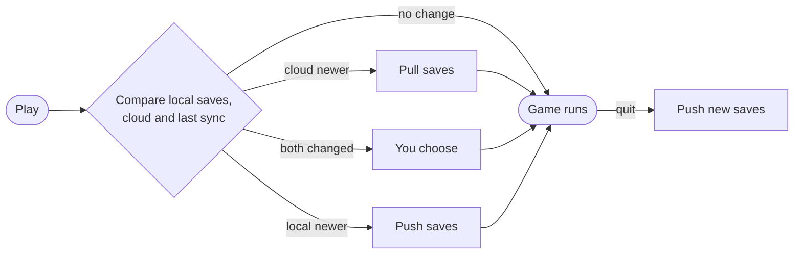

<p align="center">
  
</p>

<h1 align="center">Carryover</h1>

<p align="center">
  <strong>Carry your game saves between PCs, Macs, Steam Deck and Android using your own cloud storage.</strong>
</p>

<p align="center">
  <a href="https://github.com/akfaiz/carryover/releases"></a>
  <a href="https://github.com/akfaiz/carryover/actions/workflows/ci.yml"></a>
  <a href="https://codecov.io/gh/akfaiz/carryover"></a>
  <a href="https://github.com/akfaiz/carryover/releases"></a>
  <a href="go.mod"></a>
  <a href="LICENSE"></a>
</p>

<p align="center">
  <a href="#download"></a>
  <a href="#download"></a>
  <a href="#download"></a>
  <a href="#download"></a>
  <a href="#download"></a>
</p>

A game launcher for Windows, macOS and Linux / Steam Deck, with an Android app, that keeps your save
games in sync through your own cloud storage. Carryover pulls the latest saves before you play and pushes them when
you quit, from its own launcher or from Steam, including Game Mode.

Cloud storage: Google Drive, Dropbox, OneDrive, WebDAV (Nextcloud, ownCloud, NAS), SFTP and SMB.
[rclone](https://github.com/rclone/rclone) is built in, so there is nothing else to install.

## Screenshots

<p align="center">
  
</p>

## Features

- **Per-device save paths** — one game, one cloud copy; each device maps it to its own folder
  (`{appdata}/GameA` on Windows, `{proton:shortcut}/AppData/Roaming/GameA` on a Steam Deck).
- **Save locations suggested** — known save folders for ~21,000 games, translated for each device, including
  Proton, Heroic, Lutris and Bottles prefixes on Linux. Emulators get theirs from the emulator's own manifest, on
  the desktop and in the Android app.
- **Play from the launcher or from Steam** — "Add to Steam" creates a shortcut that syncs around every session,
  even in Game Mode, with prompts that work on a controller. On Linux, Heroic and Lutris games are started
  through their launcher so they keep its Wine prefix.
- **Controller support** — added to Steam itself, the whole app works with a gamepad in Game Mode: the D-pad
  moves between games and buttons, A presses, B goes back, and text fields open Steam's keyboard.
- **Safe conflicts** — if saves changed on both sides, you choose which to keep, and the side being overwritten
  is backed up first. Backups can be listed, pinned and restored from the game's page (on the desktop and in the
  Android app).
- **Emulators** — set up an emulator (Eden, Ryujinx, …) once per device and let a game use several; each keeps
  its own saves in the cloud. Choosing a ROM suggests the game's name and save folders.
- **Android** — play emulated games on a phone, handheld or TV with the same cloud saves as on your
  PC: Play syncs, starts the emulator and uploads the saves when you leave the game. Frontends such as ES-DE and
  Daijisho can start games through it, and an Android-only emulator such as Lemon can share Eden's saves with the PC.
- **Played without Carryover?** — games whose saves changed outside Carryover are marked "not uploaded".
- **Shared library** — the game list, covers and artwork sync between devices; a game added on the PC shows up on
  the Deck as "needs setup". Titles come from Steam, covers from SteamGridDB (with your own free API key; the Android app finds covers and backgrounds too).
- **Trash and cleanup** — deleted games and emulators can be restored for 30 days, and cloud saves no game uses
  any more can be restored or deleted (on the desktop and in the Android app).

## Download

Get the latest version from the [Releases page](https://github.com/akfaiz/carryover/releases/latest).

Every file is named `carryover-<version>-<os>-<arch>`, for example `carryover-0.5.1-windows-amd64.zip`.
On Windows, pick the installer or the portable zip; both hold the same program.

| Platform | File | How to run |
|---|---|---|
| Windows (installer) | `carryover-<version>-windows-amd64-setup.exe` | Run it. Installs for your user only (no admin needed) into `%LOCALAPPDATA%\Programs\Carryover`, with a Start menu entry and an uninstaller. |
| Windows (portable) | `carryover-<version>-windows-amd64.zip` | Extract `carryover.exe` and run it from any folder. |
| Steam Deck, Linux | `carryover-<version>-linux-amd64.AppImage` | Rename it to `carryover.AppImage`, make it executable (file Properties → Permissions, or `chmod +x`) and run it. |
| Linux | `carryover-<version>-linux-amd64.tar.gz` | Extract it and run `./install.sh` (installs into `~/.local` and adds a menu entry), or `sudo ./install.sh /usr/local` for every user. |
| macOS 12+ (Apple Silicon and Intel) | `carryover-<version>-macos-universal.zip` | Open the zip and drag the extracted Carryover to Applications. |
| Android 8+ | `carryover-<version>-android-arm64-v8a.apk` (phones, handhelds, TV boxes; `…-x86_64.apk` for Chromebooks) | Open it on the device and allow your browser or file manager to install apps when Android asks. |

- **Keep the app in one place, under one name.** Steam shortcuts made with "Add to Steam" point at the file's path,
  which is why the exe and AppImage carry no version in their name. Put them in a folder you won't move them out
  of (for example `~/Applications` on the Deck). On the Deck, run it from Desktop Mode the first time.
- **Windows warns on first run.** The installer and exe aren't code-signed yet, so SmartScreen shows "Windows
  protected your PC"; choose **More info → Run anyway**.
- **macOS blocks the first start.** The app isn't signed with an Apple Developer ID or notarized, so macOS says it
  can't check it for malware. Open it once, then go to System Settings → Privacy & Security and choose
  **Open Anyway**. From Terminal, `xattr -dr com.apple.quarantine /Applications/Carryover.app` does the same.
- **Android asks once for Usage access.** It lets Carryover see that you left a game, to upload its saves right away.
  On Android 13+, an app installed from a downloaded file must be unlocked for it first: App info → ⋮ → **Allow
  restricted settings**; the app shows you where. A new version installs over the old one and keeps your setup;
  uninstalling removes the app's settings on the phone, not your cloud saves.
- **Check a download** against `SHA256SUMS.txt` from the same release: `sha256sum -c SHA256SUMS.txt --ignore-missing`
  on Linux, `shasum -a 256 -c SHA256SUMS.txt --ignore-missing` on macOS, or compare the output of
  `Get-FileHash <file>` in PowerShell on Windows.
- **Updating:** run the new installer over the old install, or download the new version and put it over the old
  file (`carryover.exe` from the zip, or the renamed `carryover.AppImage`), so Steam shortcuts keep working. The
  AppImage can also update itself through [Gear Lever](https://flathub.org/apps/it.mijorus.gearlever) or
  AppImageUpdate (full releases only, not pre-releases). For the tarball, run `install.sh` from the new version.
  On macOS, replace `/Applications/Carryover.app` with the new one.
- **Uninstalling** (installer): Windows Settings → Apps. Your settings, library and cloud configuration in
  `%APPDATA%\Carryover` are kept; both Windows versions use that folder, so you can switch between them. On macOS,
  move Carryover.app to the Trash; settings stay in `~/Library/Application Support/Carryover`.
- `carryover --version`, or Settings → About, shows which version you have.

## Getting started

On each device:

1. **Cloud storage** — add a remote with "＋ Add remote" (or import your existing rclone config, on the desktop and in the Android app). The first one
   becomes the sync location; check its folder under "Sync location". Every device must use the same remote and
   folder.
2. **＋ Add game** — choose "From Steam", "PC game" or "Emulated game", then set how it starts and its save folder
   on this device. Suggested save locations are listed for known games.
3. **▶ Play**, or use "Add to Steam" and start the game from Steam. On the other device, the game shows up as
   "needs setup": set its save folder there, and the saves follow you. For Proton and Heroic games, see
   [Steam and Steam Deck](docs/steam-deck.md).

**On Android**, add the same cloud account and folder under Settings → Cloud. Games your PC plays with an emulator
that has an Android app show up. On the Emulators tab, choose which app each emulator is; on a game's page, pick its
save folder (**Suggest save folders** finds it for emulators it knows) and press **Play**. To start games from
ES-DE or Daijisho, see [Android: start games from a frontend](docs/android-frontends.md).

## How it works



Each game has one copy of its saves in the cloud. Before you play, Carryover compares the local saves, the cloud
copy and what it saw at the last sync, then pulls, pushes, or asks you when both sides changed. Only changed files
are transferred, and a cloud lock shows when the game is being played on another device. After you quit, the new
saves are pushed. See [How Carryover syncs saves](docs/how-it-works.md) for the details and the backup options.

> [!NOTE]
> **Steam's "Exit game" / "Stop" is fine.** Carryover still uploads your saves a few seconds later and lets you
> know with a notification (in Steam Deck Game Mode, the next time you open Carryover). On Linux this needs systemd,
> which SteamOS has; without it (e.g. Flatpak Steam), press "Sync now" before you play on another device.

## Command line

```
carryover                       open the launcher
carryover run <game> [-- cmd]   pull → play → push (used by Steam shortcuts)
carryover sync <game>|--all     manual sync (exit code 3 = conflict)
carryover list                  list games and their ids
```

All options are in [docs/cli.md](docs/cli.md).

## Documentation

- [How Carryover syncs saves](docs/how-it-works.md) — conflicts, backups, the cloud lock
- [Steam and Steam Deck](docs/steam-deck.md) — Proton shortcuts, Heroic games, Game Mode
- [Save paths](docs/save-paths.md) — every path variable (`{appdata}`, `{proton:shortcut}`, …)
- [Command line](docs/cli.md) — commands, options and environment variables
- [Android: start games from a frontend](docs/android-frontends.md) — ES-DE, Daijisho, home-screen shortcuts
- [Troubleshooting](docs/troubleshooting.md) — logs, SmartScreen, missing uploads, Android
- [Compared with other tools](docs/comparison.md)
- [Privacy policy](PRIVACY.md)

## Compared with other tools

[Ludusavi](https://github.com/mtkennerly/ludusavi) backs up and restores saves on one machine.
[OpenSave](https://github.com/Liquid-co/OpenSave) syncs every change peer-to-peer between paired devices.
[EmuSync](https://github.com/emu-sync/EmuSync) syncs saves to your cloud storage from a background service on a timer.
[Hoard](https://github.com/rleeon/hoard) keeps every version of your saves on a Hoard server, hosted or your own,
from a background service.
Carryover keeps one copy in your own cloud storage and syncs it around each play session. See
[docs/comparison.md](docs/comparison.md) for a side-by-side comparison.

## Building from source

See [CONTRIBUTING.md](CONTRIBUTING.md) for build, test and Linux / Steam Deck, macOS and Android packaging
instructions, [Architecture](docs/architecture.md) for how the code is organised, and
[Android architecture](docs/android-architecture.md) for how the Android app works.

## License

Carryover is free software under the [GNU General Public License v3.0 or later](LICENSE) (GPL-3.0-or-later)
© 2026 Ahmad Faiz.

## Credits

- Save locations come from the [Ludusavi manifest](https://github.com/mtkennerly/ludusavi-manifest)
  (MIT), compiled from [PCGamingWiki](https://www.pcgamingwiki.com/).
- Save locations of emulated games come from
  [ludusavi-emulator-manifests](https://github.com/sharkusmanch/ludusavi-emulator-manifests), downloaded on demand
  when you use the suggestion feature (built from public game databases such as blawar/titledb and GameTDB).
