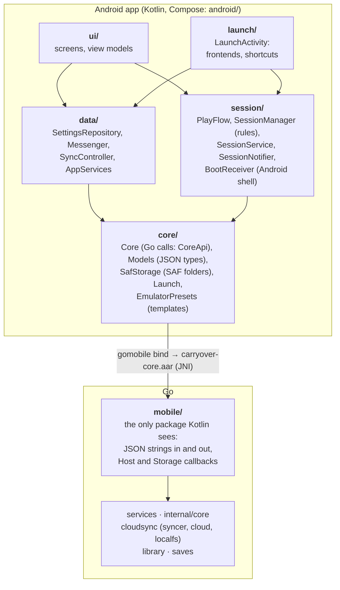

# Android architecture

The Android app shares the cloud layout, the library and the sync logic with the desktop app, so a
game played on a PC and on an Android phone, handheld or TV uses the same cloud saves. It covers games played in
emulators and Android games whose save folder the app can reach. How the Go code both apps share is organised:
[Architecture](architecture.md). Building and releasing: [CONTRIBUTING.md](../CONTRIBUTING.md#android).

## Why it differs from the desktop

On the desktop, Carryover wraps the game (`carryover run ... -- %command%`): it syncs, starts the game as a child
process, waits for it to exit and syncs again. Android allows none of that: an app starts another with an `Intent`
and can't wait for it, emulators stay open after a game ends, scoped storage hides other apps' folders, and
background work needs a foreground service.

So the app is a **launcher plus listener**: it starts the game itself after syncing, and watches for the game
leaving the screen to upload.

## Look

The app looks like the desktop's launcher look ([Look and feel](architecture.md#desktop-gui)): the same palette, corner
radii (6, 8 and 12dp), card and badge styles, one empty-state style and the desktop's words for a game's status
(Running, Needs setup, Conflict, Sync error, Not uploaded, Synced, Not synced). It keeps Android's own navigation: a
bottom bar (a rail on wide landscape screens), Material 3 text fields and a floating button for adding.

`ui/Theme.kt` holds the palette, shapes and type, and `ui/Kit.kt` the building blocks, the twin of the desktop's `ui/kit`:
`AppButton` (primary, secondary, danger, ghost), `Callout`, `Pill`/`StatusBadge`, `EmptyState`, `SectionCard`/`SubCard`,
`ListRows`, `ChoiceRow`, `PageTopBar` and `PageColumn` (centered, at most 760dp wide, one set of gutters). Screens use these and
not Material's raw buttons and cards, radii or colours of their own: `StyleTest` fails on those (a line that has a
reason says `style:ok`). The one place Android differs on purpose from the desktop palette is the dark theme's text on
the accent, which is dark so it stays readable.

## Layers

- **`mobile`** wraps `services` for gomobile, which passes only basic types and interfaces: every call takes and
  returns JSON. `services` is the same API the desktop GUI uses, so both apps follow the same rules; `mobile` may
  read `internal/core` directly but every change goes through `services` (`TestMobileWritesThroughServices`). `Host` (implemented in Kotlin) receives what `services.Bus` reports on the desktop (library changes,
  sync progress, play-session status and questions) and opens rclone's OAuth page in the browser. `Init` sets `HOME`
  (shared storage, so `{home}` is `/storage/emulated/0`), `TMPDIR` and `XDG_*`, which an app process doesn't have;
  the data dir is the app's private `files/carryover`, laid out like the desktop's.
- The whole core builds for `GOOS=android` unchanged (it also satisfies the `linux` build tag, so `_other.go` files
  are compiled in).

## Code structure

Dependencies point down: `ui` and `launch` use `data` and `session`, which use `core`; `core` imports none of them
(`LayeringTest`).

- **`core.CoreApi`** is the bridge to the Go core, implemented by the `Core` object; `SessionCore`,
  `SettingsCore`, `SyncCore`, `BackupCore`, `TrashCore` and `ArtCore` are the parts the session code, the settings, syncing,
  backups, the trash and artwork need, so those can be tested against a small fake.
  Words the core sends are enums (`SyncAction`, `NoticeKind`,
  `PromptKind`, and the `Resolution` and `Answer` the app sends back, in `Models.kt`); a value an older app doesn't
  know reads as the default (`None`, `Unknown`), not as a crash.
- **`data/`** holds what several pages share: `SettingsRepository` (the core's settings and the cloud accounts with
  the app's own preferences, one state: the theme, whether a cloud is set up, the grace period; plain Kotlin over
  `SettingsCore` and a `PreferenceStore`, unit tested), `Messenger` (the snackbar messages and the "X failed" text) and
  `SyncController` (which games are syncing, a conflict waiting for the user, progress, and how each sync went; plain
  Kotlin over `SyncCore`, unit tested), and `AppServices`, what the view models are built from, installed by the
  Application. `AppPlatform` is what they need of Android itself (starting a game, the session service, shortcuts,
  covers, logs; `AndroidPlatform` is the real one) and `Texts` the app's catalog behind `Messenger`.
- **View models** are one per area: `AppViewModel` (library and play, with a `SyncController` for syncing; it composes the
  one `UiState` the pages read), `SettingsViewModel`, `CloudViewModel`, `TrashViewModel`, `BackupsViewModel`, `SuggestViewModel`, `ArtViewModel` and `LaunchViewModel`. Settings and cloud pages
  read the repository's state; the library page only learns whether a cloud is set up and reloads when one was
  connected. They are plain `ViewModel`s that use no Android class (`LayeringTest`): the constructor takes
  `AppServices.shared` by default, which is what the framework's factory uses, and a test passes fakes.
  `LaunchViewModel` is made for one launch: `LaunchActivity` gives it an `AndroidLaunchPlatform` (the intent that came in
  as a `LaunchRequest`, the forwarded intent, app labels), and `LaunchPlanner` decides what the launch asks for.
- **Screens** (`ui/`, except `*ViewModel.kt`) don't touch `Core`, `AppPrefs`, `AppServices`, `SettingsRepository`,
  `SessionManager`, `SessionService` or `BackgroundSync`: a view model is where the state meets them (`LayeringTest`
  checks it).
- **The session rules have no Android classes**: `SessionManager` (what is watched, when a session ends, what a failed
  upload does, what `recover` picks up), `PlayFlow` (starting a session), `PendingUploads` (the retry) and
  `FrontState`. Android comes in through small interfaces: `FrontSource` (`UsageFrontSource`), `SessionNotices`
  (`SessionNotifier`) and `SessionHost` (`SessionService`). They are unit tested against a fake `SessionCore`
  (`session/Fakes.kt`). `SessionService` is only the shell: the foreground service, the poll and the commands.
- **Startup**: `Core.init` runs in `Application.onCreate`, on the main thread. It is short (the log says
  `core init took N ms`), so it stays synchronous: moving it would need an "initializing" state in the service, the
  worker, the boot receiver and every view model.
- **Not covered by unit tests** (they need a device or an emulator): the Compose screens, the service's lifecycle, the
  notifications, SAF file access, `AndroidPlatform` / `AndroidLaunchPlatform`, and the JNI wrapper `Core`. The rest
  (session rules, repository, sync, the view models, the launch planner and display logic) runs on the JVM
  against fakes: `FakeCoreApi`, `FakeAppPlatform` and `FakeLaunchPlatform` in the test sources, with a test Main
  dispatcher (`kotlinx-coroutines-test`), so `./gradlew testDebugUnitTest` is the whole check.

## Play sessions

A game is started from Play in the app, from a frontend (ES-DE, Daijisho) that launches Carryover in place of the
emulator, or from a home-screen shortcut. All three go through `Sessions.play`:

1. **Start** (`mobile.BeginSession` → `Core.StartSession`): the desktop's `beginPlay` without the launch: local
   lock, sync before playing, questions (conflict, another device's lock, failed sync) shown while Carryover is in
   front, cloud lock, and a session marker (`state/<CloudKey>.session`) with `detached: true`. The local lock is
   released; the open marker is what keeps manual sync, backup and restore away (`core.ErrPlaying`).
2. **Launch**: an Intent built from the profile's launch settings, granting read access to a `content://` game file.
3. **Watch** (`SessionService`, a foreground service): polls `UsageStatsManager` and ends the session when another
   app came to the front and the game's didn't come back within the grace period (10 s, 30 s or 60 s: Settings →
   Play sessions), when the game never came to the front within 60 s, on **Done playing** in its notification, or,
   without Usage access, when the user comes back to Carryover. The decision is `session/Front.kt` (unit tested):
   system screens over the game (permission prompts, the file picker, Google sign-in) don't count as leaving it.
   A second request to end a session that is already being ended is ignored, and starting the game again waits for
   the upload in progress (`Sessions.awaitEnded`), so a new session can't lose its lock to the old one's release.
4. **End** (`mobile.EndSession` → `Core.EndSession`): upload only (a conflict is flagged), release the cloud lock,
   and a notification with the result. When it fails (offline, an expired login), the session is over all the same:
   the marker is kept but marked `ended`, so the next play syncs before playing and manual syncs run again.
   `SyncWorker` (WorkManager) then finishes the upload once there is a network (`Core.EndPending`, which never
   touches a session that was started again).

After a session ended because the user left the game, the service stays up for 10 minutes (its silent notification
says so) to see whether the game comes back. If it does, a notification offers to sync and watch it
again: it opens `LaunchActivity` with `carryover.track`, which begins a session without starting the game.

The marker outlives the app's process: the service picks up open sessions when it restarts, and `BootReceiver` ends
them after a reboot. A game started outside Carryover isn't synced around; the next sync catches up, and real
divergence is a conflict, as on the desktop.

**Frontends and shortcuts** reach `LaunchActivity`, which is exported. It matches the launch's game file against the
game files set up on this device (asking once when unknown), then forwards the launch to the emulator. Since any app
can call it, it starts only apps set up here as an emulator or a game's app, never Carryover, and passes on only the
URI grants the caller gave (`launch/Forward.kt`). How to set up a frontend is in
[Android: start games from a frontend](android-frontends.md).

## Launch settings

Android keeps them in the per-device fields the desktop already has, read only by the device that owns them, so the
catalog didn't change:

| Field (this device's entry) | On Android |
|---|---|
| `EmulatorDevice.Exe` | the emulator app: `package` or `package/activity` |
| `EmulatorDevice.Args` | optional template that starts a game directly, in `am start` syntax with `{rom}` |
| `EmulatorConfig.Rom` | the game file: a path or a `content://` URI |
| `DeviceConfig.Exe` | an Android game's package |

Without a template or a game file, the emulator opens and the user picks the game there.

## Save folders

- **Granted folders** (the default): the system folder picker grants access to a folder, stored per device as
  `:saf:<authority>/<tree document id>[/]`. Such a folder has no file path, so `internal/cloudsync/localfs`
  routes every save-folder read and write in `syncer` to the app's `Storage` (files passed as file descriptors, so no
  data crosses JNI), and transfers go through a hidden rclone backend, `saf`. Every other path uses `os` as before.
  An emulator's own data folder is reachable this way when the emulator publishes it in the picker.
- **File paths** work with the optional All-files access.
- **Switch** (Eden, Lemon, Citron, …): *Suggest save folders* (`mobile.SuggestSaves`) takes the title ID from the game
  file's name, or from another device's paths for the game when the name has none, and the profile from this
  device's `profiles.dat` (read through `localfs`, so a granted folder works), so the profile ID never enters the
  cloud layout.

## Save locations (slots)

A profile (a game's own saves, or an emulator's) can keep several save locations, such as a game's saves and its save
states. They are `SaveSlot`s, shared by every device; each device sets its own folder per slot on the game's page.
A game added on Android starts with one slot (`saves`); **Edit game → Save locations** adds, renames and removes
slots (`mobile.SetSlots`):

- A slot's key names its cloud folder, so it never changes: an existing slot only changes its label (and keeps its
  filters). A new slot's key is made from its label (`Save states` → `save-states`, numbered if taken).
- Removing a slot drops it from the profile and this device's folder for it; its files in the cloud stay. The last
  slot can't be removed.
- A profile that uses another emulator's saves (`ShareWith`) has no slots of its own: change them on the emulator it
  shares with.
- Refused while the profile is being played (`core.ErrPlaying`).

## Signing in to a cloud

Settings → Cloud → **Add a cloud account** runs rclone's OAuth flow: the core listens on `127.0.0.1:53682`, the app opens
the browser at that address (it forwards to the provider), and the provider's redirect comes back to the same port.

- rclone asks first whether to use a web browser; the core answers yes itself (`mobile.answerBrowser`), so the browser
  opens right after **Connect**.
- While the app waits there is a **Cancel** button (`mobile.CancelSignIn` → `CloudService.CancelSignIn`). It ends the
  wait, frees the port and drops the account the flow had begun.
- rclone writes the remote when the flow starts, so a sign-in that was abandoned (the app was closed, the browser never
  got back) leaves an account with no token. `cloud.Remote.Incomplete` flags it: the Cloud page shows it as "Sign-in
  not finished", can't select it, and only offers Delete.

## Cloud accounts from an rclone.conf

Signing in to a cloud on a phone is clumsy, so Settings → Cloud → **Import from an rclone.conf file** copies the
accounts from the `rclone.conf` of a PC (the desktop's import, `cloud.ImportConfigData`, through
`mobile.ImportRcloneConfig`):

- The user picks the file with the system picker; the app reads it (at most 1 MB) and hands the **text** to the core, so
  the tokens in it are never copied to a file of the app's own: they go straight into Carryover's `rclone.conf`.
- Only the supported kinds (Google Drive, Dropbox, OneDrive, WebDAV, SFTP, SMB) are copied. One message says how many,
  which accounts **replaced** one of the same name (its old settings are gone) and which were left out. An encrypted
  config is refused.
- An account that points at a file on the PC (SFTP with `key_file`) imports but needs its key again here.

`CloudViewModel` reads the accounts again afterwards; choosing the folder and "Use this cloud" stay the user's step.

## Suggested save folders

For an emulator of a known type (its `Preset`, which the app sets from the emulator's package) with a data folder on this
device, the desktop's lookup in the emulator manifests (`emumanifest`, downloaded the first time) is on Android too,
through `mobile/suggest.go`:

- **A game's page → an emulator profile → Suggest save folders** lists where the emulator keeps this game's saves, found
  by the game file's title ID (`romFileName` reads it from a `content://` document URI) or the game's name, and which of
  them are on this device (`localfs.Exists`, which looks into granted folders too). **Use** makes one this device's
  folder; the filters the manifest gives go into the slot, like the desktop editor does. A kind of save that differs per
  device (Switch's account and device saves) goes into the slot of that name, or an unused default slot becomes it
  (never one another device has a folder in: its key names the cloud folder).
- **Adding a game** with no save folder tries the same in the background and fills in what is on the device.
- Android has no usual data folder to start from (the desktop ones don't exist), so the data folder has to be chosen
  first (Emulators). `SuggestViewModel` is the dialog and `SuggestCore` the part of the core it uses.

## The library on Android

- The app shows only what plays here: emulators set up on this device or of a kind with an Android app
  (`EmulatorPresets.onAndroid`), games through those emulators, and a game's own saves only once this device has a
  folder or an app for them, or has an entry for the game (`GameView.forAndroid`, `hasDevice`: a game recovered from
  the cloud is still to be set up), so PC games are left out.
- The device's ID comes from the system's identifier of the device for this app (`ANDROID_ID`, which survives
  reinstalling the app and clearing its data): a first start sets it to `appdir.DeviceIDFrom("android:" + id)`, a
  name-based UUID, so the raw identifier never reaches the library. A clean install is then the same device as before
  and its games are set up again at once, except its picked folders (the system drops those permissions on
  uninstall). A factory reset or a build signed with another key (debug vs release) gives another ID.
- Editing a game changes it for every device. An emulator can share another's cloud saves
  (`GameEmulator.ShareWith`): Lemon, Android-only, next to the PC's Eden plays the same Switch saves.
- Settings → Cloud has two switches, the desktop's too: **Share the library between devices** (`Settings.SyncLibrary`,
  on once a cloud is chosen; off keeps this library on this device, so other devices' games don't appear) and
  **Sync covers and artwork** (`Settings.CoversLocalOnly` turned around; only while the library is shared). Turning
  one on merges the library with the cloud at once; a merge that fails is said and does not undo the setting.
- Settings shared with the desktop live in the core (`Settings.Theme`, covers, the library); the language is the
  app's own (`AppLanguage`). UI text is in `res/values` with Bahasa Indonesia in `res/values-in`; messages from the
  Go core stay English, as on the desktop.

## Trash

The trash is the desktop's (`library.TrashRetention`, 30 days), reached through `mobile/trash.go`, so a user who only
has Android can also delete and clean up. Deleting a game or an emulator moves it to the trash on all devices and
keeps its cloud saves. Settings → Trash restores it or deletes it for good, with or without its cloud saves
(`withSaves`: saves, backups and lock), and lists the cloud saves no game uses (read from the cloud only when asked)
to bring back or delete. `TrashViewModel` is the page and `TrashCore` the part of the core it uses; deleting is in
`AppViewModel`.

## Backups of the saves

The backups are the desktop's (`syncer` zips, see "How Carryover syncs saves"), reached through `mobile/backup.go`, so
a user who only has Android can undo a bad overwrite too. Settings → Cloud backups is `Settings.BackupRetention`,
shared with the desktop (0, off, is the default); with it off, a download that replaces this device's saves still
keeps a copy on this device only. A game's page lists the backups per profile, since each emulator has its own saves:
back up now, pin, delete and restore. Restoring backs up the saves it replaces first, and backing up and restoring
can be cancelled. `BackupsViewModel` is the page and `BackupCore` the part of the core it uses; restoring changes the
game's status, which reaches the library through the core's library event like a sync does.

## Covers and backgrounds from SteamGridDB

With the user's own SteamGridDB API key (`Settings.SteamGridDBKey`, shared with the desktop and checked with
SteamGridDB before it is saved) the app finds artwork the way the desktop editor does, through `mobile/art.go`. A
game's page searches by name and keeps the chosen image as the cover or as the background (the core's `hero`
artwork); the library's cover search finds a cover for every game without one, taking the best match (`ArtPicks`) and
stopping after two failures in a row. The core downloads only from SteamGridDB's hosts over https, and the app
fetches thumbnails itself only from `*.steamgriddb.com` over https (`rememberRemoteImage`, `isGridImageUrl`).
`ArtViewModel` is the page and `data/CoverFinder` the bulk search (plain Kotlin over `ArtCore`).

## Permissions

| Permission | Used for |
|---|---|
| Usage access | seeing that a game was left (otherwise Done playing) |
| Notifications | session and result notifications |
| All-files access (optional) | save folders given as file paths |
| Foreground service (`specialUse`) | watching a session until it is uploaded |
| Boot completed | ending sessions left open by a reboot |
| Network state (WorkManager) | finishing uploads after being offline; the optional background sync |
| Install unknown apps (`REQUEST_INSTALL_PACKAGES`, optional) | installing a newer version of Carryover |

On Android 13+ an app installed from a downloaded APK must unlock Usage access first (App info → ⋮ → Allow
restricted settings); the app explains this.

## Background sync

Off by default (Settings → Play sessions → Sync in the background). When on, WorkManager syncs every game every
6 hours, only while the device is charging, idle and on an unmetered network, so no game is being played. It is the
same as **Sync all**: it also downloads saves that changed on another device, and a conflict is flagged on the game.

## Updating

The core does what the desktop does (`services.UpdateService`: the channel setting, the 12-hour check, the
download checked against `SHA256SUMS.txt`); only installing differs. Its ABI is the one the Go core was built for
(`update.AndroidTarget(runtime.GOARCH)`): gomobile builds one core per ABI and each APK holds one. The APK goes to
`cacheDir/updates/`, which `res/xml/file_paths.xml` lets the app's `FileProvider` share, and the app hands it to the
system installer (`AppPlatform.installApk`), which asks the user. Installing ends the app, so the app doesn't start
the installer while a game is played or synced (`Mobile.updateBusy`). Android only accepts an update signed with the
same key and with a higher version code, which release builds have (see CONTRIBUTING.md, "Releases"). Debug builds
report "dev" and never update.

## Limits

- Games started outside Carryover aren't synced before or after, apart from the optional background sync.
- `Android/data` folders are reachable only through an emulator's own picker entry (no Shizuku or root). So an
  emulator is a preset (`EmulatorPresets`) only if its saves can be reached: it publishes a documents provider (Eden,
  Dolphin, RetroArch, Vita3K) or keeps them in a folder you pick (PPSSPP, Azahar, melonDS, ScummVM). NetherSX2 /
  AetherSX2 and DuckStation keep theirs in `Android/data` with no provider, so they are not offered (one already set
  up on a device still works as far as it can). PPSSPP and ScummVM fall back to `Android/data` until you pick a
  folder in the emulator; an emulator's page and a game's profile say so (`EmulatorPreset.savesNote`).
- Not yet verified on a device with every emulator and frontend: the direct-start templates, the emulators' picker
  entries (Lemon, Citron and yuzu are assumed to publish Eden's) and the frontends' URI grants.
