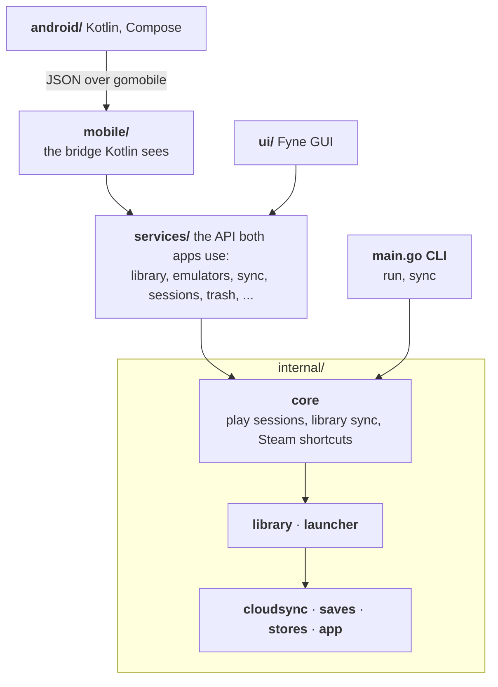
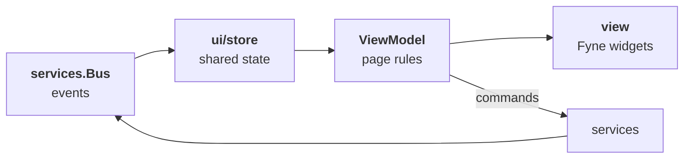

# Architecture

Carryover is one Go core with two apps on top: the desktop app (a Fyne GUI and a command line, for Windows,
Linux and macOS) and the Android app (Kotlin, over the same core built with gomobile). Both read and write the
same library and cloud layout, so a game's saves follow it from a PC to a Steam Deck to a phone.

This page is the map. How syncing behaves for a user is in [How Carryover syncs saves](how-it-works.md), and
the Android app's own design in [Android architecture](android-architecture.md). Building, testing and releasing
are in [CONTRIBUTING.md](../CONTRIBUTING.md).

## Layers



Dependencies only point down. The command line is small and calls `internal/core` directly; the two GUIs go
through `services`.

## Code map

`internal/` is grouped by layer. A package may import from its own group or from a group below it, never from
one above (`core` is the top). Put a new package in the group that matches what it knows about.

| Package | What it does |
| --- | --- |
| `internal/core` | Wires everything together: play sessions and session markers, library sync, Steam shortcuts, covers, deleting and leftovers. Used by `services` and the command line. |
| `internal/library` | The game catalog: games, emulators and each device's setup of them, merged per device by `UpdatedAt`. |
| `internal/launcher` | Starts a game (or a macOS `.app` bundle) and waits for it to exit. |
| `internal/cloudsync/` | `syncer` (the sync decision, transfers of the difference, backups, locks), `cloud` (the rclone wrapper; the supported backends are listed in `backends.go`) and `localfs` (save folders without a file path, such as Android's Storage Access Framework). |
| `internal/saves/` | Where saves live: `ludusavi` (the embedded save-location index, generated by `go run ./internal/saves/ludusavi/gen`; never edit it by hand), `emumanifest` (per-game emulator manifests, downloaded on demand), `ryujinx` and `yuzu` (those emulators' own save indexes and profiles) and `pathvar` (path tokens such as `{appdata}`). |
| `internal/stores/` | Other launchers and stores on the device: `steam` (VDF files, shortcuts), `steamgrid`, `steamstore`, `heroic`, `lutris`, `flatpak` and `wineprefix`. |
| `internal/app/` | Plumbing: `appdir` (data dir, settings), `applog` (log file), `version`, `singleinstance`, `detach` (starts the session watcher outside Steam's process tree), `notify` (desktop notifications) and `gamemode` (Steam Deck Game Mode). |
| `services/` | The API over `internal/core` that both apps use. It reports changes through `services.Bus`. |
| `mobile/` | The gomobile bridge for Android: JSON in and out of `services`, plus the `Host` and `Storage` callbacks. |
| `ui/` | The desktop GUI, split by role (see [Desktop GUI](#desktop-gui)). |
| `main.go` | Entry point: the GUI, and the `run`, `sync`, `list` and `finish-session` subcommands. |

## One API for both apps

`services` holds the rules both apps follow, so a fix there reaches the desktop and Android at once.

- **Changes go through `services`.** It takes the game's locks, refuses to touch saves while a session is open
  (`core.ErrPlaying`) and tells the app through `services.Bus`. `mobile` may read `internal/core` directly, but
  never changes anything through it; `TestMobileWritesThroughServices` lists the reads it may make.
- **No platform assumptions.** `services` knows nothing of Fyne, Steam-only or Android-only behaviour. A platform
  choice is passed in as a parameter (`defaultRootOn(goos, ...)`), so both apps can be tested from any host.
- **Events.** `services.Bus` reports library changes, play-session status, prompts and sync progress, on any
  goroutine. On the desktop `ui/store` is its only listener; on Android `mobile` forwards them to `Host`.
- **Messages from `services` are English.** The Android app shows them inside its own translated texts.

## Syncing a game

1. A game's saves are one or more *slots* (folders, with optional include filters). The syncer scans them
   through `localfs` and compares them with the cloud's `manifest.json` by size and SHA-256.
2. `syncer.Decide` compares both sides with the state last synced on this device: push, pull, nothing, or a
   conflict for the user to settle.
3. Only the difference is transferred: the changed files are uploaded or downloaded and the rest removed. The
   side being overwritten is backed up first when backups are on.
4. A cloud lock (`lock.json`) marks a game as being played on one device, and a local lock keeps two syncs of
   the same game on one device apart.

Every sync takes a `context`, so it can be cancelled. Without a network, the probe in `Core.Online` fails fast,
the game starts without syncing and the upload is retried later.

## Play sessions

- **Desktop.** Carryover wraps the game: Steam runs `carryover run <game> -- %command%`, which syncs, starts the
  game, waits for it and syncs again. Because Steam can kill the wrapper with the game, `Play` writes a session
  marker and starts a detached watcher (`carryover finish-session`) that uploads once the wrapper is gone.
- **Android.** An app can't wait for another, so the session is detached: `StartSession` syncs and writes the
  marker, the Kotlin app starts the game and watches for it to leave the screen, and `EndSession` uploads. See
  [Android architecture](android-architecture.md#play-sessions).

## Desktop GUI

The GUI is MVVM-lite with one-way data flow:



| Package | Role |
| --- | --- |
| `ui/kit` | Reusable Fyne widgets, layouts, palette and theme, toaster, image cache, gamepad navigation. Pure Fyne: no `lang`, `services` or `core` imports and no user-visible text (callers pass labels in). |
| `ui/i18n` | Translation catalogs (`translations/*.json`) and their loading. |
| `ui/store` | The state every page shares (games, settings, session status, transfer progress, "Sync all"). The only listener of `services.Bus`; pages subscribe by topic. |
| `ui/env` | What a page may use of the app: `env.Env` (window, services, store, navigation, toasts) and the page contracts (`Page`, `Stateful`, `Guarded`, `Searchable`, `Syncable`, `PadFocuser`, `Redrawable`). |
| `ui/components` | Shared widgets and dialogs that know about the app (help text, confirm dialogs, path input, status badges). `components/emulatorform` is the emulator form the Emulators page and the game editor share. |
| `ui/flows` | Multi-step actions that open dialogs, call services and navigate: add a game, import from Steam, set the SteamGridDB key, open a game in Steam. |
| `ui/prompts` | The session prompt dialogs (conflict, lock, error, which emulator). |
| `ui/pages/<name>` | One page: `viewmodel.go` (state and rules, no widgets) and `view.go` (builds the widgets once, redraws from the ViewModel). The pages are `library`, `trash`, `settings`, `emulators`, `cloud`, `session`, `editor` and `game`; `library` is the reference. |
| `ui/shell` | The main window: sidebar, router, shortcuts, gamepad, toasts, notices and the session wrapper window. Implements `env.Env` and knows no page: the root plugs them in through `shell.Config`. |
| `ui` (root) | Composition root: `Run`, the route table (`routes.go`), the sync-problems dialog and the embedded artwork. |
| `ui/internal/uitest` | Headless test harness shared by the page tests. A page's view tests live in its package; the root `ui` package keeps only the tests that need several real pages at once. |

Imports go one way: `kit`, `i18n` <- `store` <- `env` <- `components` <- `flows`, `prompts` <- `pages/*` <- `shell`
<- `ui`. A page never imports `shell` or another page; it opens one with `env.Navigate("/game/<id>")`. Under `ui/`
only `shell` and the root import `internal/core`; the rest reaches it through `services` (`services/aliases.go`
re-exports the types the UI needs).

When you add or change a page:

- Put anything that can be decided without a widget (what shows, in which order, which empty state, what a
  button does) in the ViewModel and test it with fakes; keep widgets in the view.
- The ViewModel exposes plain state (enums, counts, `[]services.GameView`); the view turns it into text with
  `lang.L`.
- Touch widgets only on the UI goroutine; I/O goes through `kit.Async`.
- Declare the page contracts a page implements (`var _ env.Guarded = (*Page)(nil)`): the shell finds them by
  type assertion, so a missing method would otherwise fail silently.

How a ViewModel reaches the app depends on its size: `library` takes small `Source`/`Prefs` interfaces;
`settings`, `emulators` and `cloud` take a `Deps` struct of funcs; `game` and `editor` take a `Backend` interface
(`backend.go` adapts the services; tests use a fake).

## Cloud layout

Everything lives in one folder on the remote (`<remote>:<folder>`, set on the Cloud storage page):

```
library.json                                      the shared game list (and the forgotten devices)
covers/                                           cover and artwork images used by the library
games/<id>/manifest.json                          revision + SHA-256 of every save file
games/<id>/current/<slot>/…                       the saves
games/<id>/lock.json                              "being played on <device>"
games/<id>/backups/<time>_<device>_<kind>.zip     kind: local, cloud or manual; holds manifest.json + <slot>/…
games/<id>/pinned.json                            names of pinned backups (never pruned)
games/<id>.<emulator id>/…                        the same files for one emulator of a game
```

Safety copies taken before a download (when cloud backups are off) stay on the device, in
`<data dir>/safety/<id>/`.

**Emulators.** Every emulator stores saves differently, so a game gets one folder per emulator, next to its own
`games/<id>/`:

- The folder name is the *sync key*, `core.SyncKey(gameID, emulatorID)`. The syncer only sees it as `Job.GameID`,
  so locks, state files, backups, safety copies and session markers all follow it.
- Emulators (`library.Emulator`, in `library.json`) are defined once. Each device says where an emulator is
  installed, and a game's `DeviceConfig.Emulators` holds that device's ROM and save paths per emulator. The same
  emulator on two devices shares one cloud folder.
- An emulator can opt in to another emulator's folder (`GameEmulator.ShareWith`; one level only, same slot
  layout). `Job.GameID` is then the other emulator's key (`core.CloudKey`), while `Job.StateKey` stays its own, so
  each keeps its own last-synced state.

**Devices.** A device is the random ID in its `settings.json`, made on first run, so a reinstall makes a new one.
Merges keep every device's entries, so removing one takes a marker: `Catalog.ForgottenDevices` (device ID -> when)
drops that device's entries not newer than then, on every merge and when the store is written
(`Store.ForgetDevice`). The marker stays, so a stale copy can't bring the entries back, and a device forgotten by
mistake comes back with its next change. `Store.MoveDevice` + `SettingsStore.SetDeviceID` (`Core.ReuseDevice`) let an
install take an earlier ID back; its own ID is then forgotten. A catalog with forgotten devices is version 3, one
without stays version 2 so older clients keep working until a device is forgotten.

## Checks that keep the layers apart

| Rule | Checked by |
| --- | --- |
| `ui/` reaches `internal/` only through `services` (except `shell` and the root); a ViewModel imports no widgets or `lang`; `kit` stays pure Fyne | `depguard` in `.golangci.yml` |
| `mobile` changes nothing through `internal/core` directly | `TestMobileWritesThroughServices` |
| The Android app's layers (screens, view models, `core/`, `data/`, `session/`) | `LayeringTest` (Kotlin) |
| Every desktop UI text has an English catalog entry; other languages match it | `TestTranslationCatalog`, `TestLanguageCatalogsMatchEnglish` |
| Every Android UI text exists in both languages | `CatalogTest` (Kotlin) |
| The compiled-in rclone backends match the supported list | `TestProvidersMatchSupported` |
| Every control can be reached with a gamepad | `TestGamepadReachesEveryControl`, `TestGamepadReachesDialogControls` |

[`CLAUDE.md`](../CLAUDE.md) has the detailed notes: threading, rclone behaviour, platform rules and the pitfalls
met so far.
