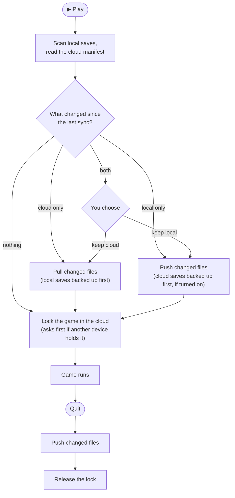
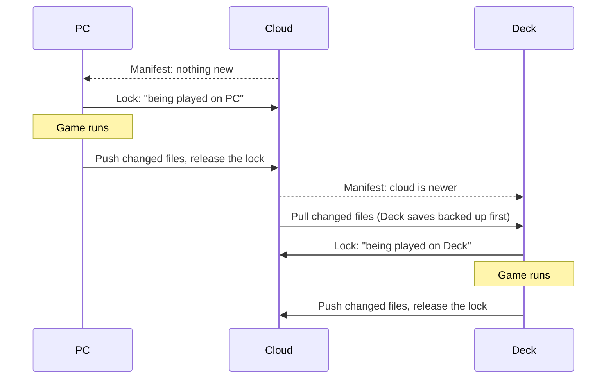

# How Carryover syncs saves

Each game has one copy of its saves in the cloud. Every device keeps a record of the cloud state it saw at its
last successful sync, and compares three things: its local save files, the cloud copy and that record.

1. **Before playing**, Carryover scans the local save folders and reads the cloud manifest (the file list with a
   SHA-256 for each file). Once the saves are in sync, it writes a lock in the cloud ("being played on
   `<device>`") so another device knows the game is in use.
2. **It decides what to do:**

   | Local | Cloud | Result |
   |---|---|---|
   | unchanged | unchanged | nothing to do |
   | unchanged | newer | **pull** the cloud saves |
   | changed | unchanged | **push** the local saves |
   | changed | changed (and different) | **conflict**, you choose which side to keep |

   A device that has never synced the game pulls if it has no local saves, pushes if the cloud has none, and
   reports a conflict if both have different saves. A save folder that went missing or was emptied is reported
   as a conflict, never uploaded as "delete everything".
3. **Only the difference is transferred.** Files are compared by size and SHA-256, so unchanged files are not
   uploaded or downloaded again, and files that were deleted on one side are removed on the other.
4. **The side being overwritten is backed up first.**
   - With **"Back up saves to the cloud before they're overwritten"** turned on in Settings (off by default,
     because the upload slows syncs), it is zipped into the game's cloud backups. The last N are kept.
   - With it off, a download that would replace this device's saves first zips them on the device
     (the last 5 per game). Nothing is uploaded.
   - "Back up now" on the game page makes a manual backup. Manual backups are pinned, and pinned backups are never
     deleted automatically. You can pin any backup, and restore any of them from the game page.
5. **After you quit the game**, the new local saves are pushed and the lock is released.

In Steam, the shortcut `carryover run <game>` does the same steps around the game process. You can cancel a sync
while it runs, but never the game itself.

> [!NOTE]
> **Steam's "Exit game" / "Stop" is fine.** Carryover still uploads your saves a few seconds later and lets you
> know with a notification (in Steam Deck Game Mode, the next time you open Carryover). On Linux this needs systemd,
> which SteamOS has; without it (e.g. Flatpak Steam), press "Sync now" before you play on another device.

## Two devices

Playing on a PC, then on a Steam Deck:

If the Deck had started the game while the PC still held the lock, Carryover would say the game is being played
on the PC and ask whether to play anyway.

## Games played without Carryover

When the launcher opens or regains focus, it checks for saves that changed since their last sync (for example, the
game was started outside Carryover) and marks those games "not uploaded". Press "Sync now" to upload them.

## Emulators

Each emulator a game uses keeps its own saves in the cloud, so they never mix; the same emulator on another device
shares them.

## What is stored in the cloud

See [Cloud layout](../CONTRIBUTING.md#cloud-layout) in CONTRIBUTING.md.
